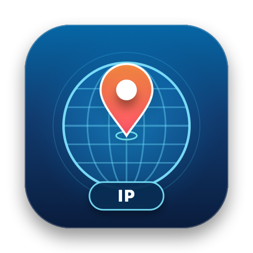

<p align="center">
  
</p>

<h1 align="center">🌍 WhereAmIP</h1>

<p align="center">
  <strong>极简、原生的 macOS 状态栏网络 IP 归属地显示工具</strong><br/>
  实时感知网络环境，一目了然看清当前外网出口 IP 所在国家与属地。
</p>

---

## 📥 下载与安装

1. 前往 [**GitHub Releases**](https://github.com/sujianjob/WhereAmIP/releases) 页面下载最新版本的 **`WhereAmIP-v1.0.0.dmg`** 安装镜像。
2. 双击打开 `.dmg`，将 **`WhereAmIP.app`** 拖入右侧的 **`Applications`（应用程序）** 文件夹。
3. **⚠️ 首次打开必看（移除 macOS Gatekeeper 隔离提示）**：  
   由于本项目采用开源免费的本地 Ad-hoc 签名（未购买 Apple 付费开发者证书公证），从浏览器下载后首次双击打开时，macOS 可能会提示 *“无法打开 WhereAmIP，因为无法验证开发者”* 或 *“文件已损坏”*。  
   只需打开「终端 (Terminal)」，执行以下一行命令即可永久放行并正常启动：

   ```bash
   xattr -cr /Applications/WhereAmIP.app
   ```

   执行后直接打开 `/Applications/WhereAmIP.app`（或在终端执行 `open /Applications/WhereAmIP.app`），屏幕右上角菜单栏即会出现当前出口 IP 的国旗图标！

---

## ✨ 核心特性

- 🚩 **状态栏即时显示**：在 macOS 顶部菜单栏显示当前出口 IP 对应的国家/地区国旗 Emoji（如 🇺🇸、🇯🇵、🇸🇬、🇨🇳）及可选的国家代码/名称/IP。
- 🔔 **出口 IP 变更即时通知**：当检测到最近一次查询出口 IP 发生变化时，自动弹出 macOS 系统横幅通知（展示新旧 IP 与归属地对比），并在菜单中记录上次出口记录，支持随时开启或关闭。
- ⚡ **轻量纯原生**：基于 Swift 6 + AppKit 开发，超低内存占用与极低 CPU 消耗，纯状态栏常驻（无 Dock 图标打扰）。
- 🧠 **三层混合智能刷新策略**（兼顾毫秒级感知、API 限流保护与 Mac 续航）：
  1. **第一层：事件即时驱动（1.5s 防抖）**
     - `NWPathMonitor` 监听 Wi-Fi 切换、插拔网线、VPN/TUN 虚拟网卡变动。
     - `SCDynamicStore` 监听系统 HTTP/SOCKS 代理配置切换与全局路由变化。
     - 监听系统睡眠唤醒 (`didWakeNotification`) 与屏幕解锁事件。
  2. **第二层：自适应低频轮询（针对纯应用内切节点）**
     - 提供 **灵敏 (2分钟)** / **平衡 (5分钟，默认)** / **省电 (15分钟)** 三档预设。
     - **智能电源感知**：通过 `IOKit` 检测供电状态，使用电池或开启低电量模式时自动拉长轮询间隔；**锁屏/合盖期间彻底暂停后台轮询**，零唤醒耗电。
  3. **第三层：交互式按需校验**
     - 点击状态栏图标展开菜单时，若距离上次刷新超过 **20 秒 (TTL)**，自动在后台静默更新。
     - 支持菜单内 `Cmd + R` 一键立即刷新。
- 🛡️ **高可用多源探测与无缓存会话**：
  - 内置 `ipwho.is`、`ip.sb`、`ipinfo.io`、`ip-api.com`、`Cloudflare Trace` 五级自动故障转移（Fallback）。
  - 每次探测采用独立 `ephemeral` 会话，杜绝切换代理节点后复用旧 Socket 连接池导致的延迟。

---

## 📁 目录结构

```text
WhereAmIP/
├── README.md
├── LICENSE
├── Package.swift                           # Swift Package Manager 构建配置
├── Resources/
│   ├── AppIcon.icns                        # macOS 多分辨率应用图标
│   └── AppIcon.png                         # 图标高清预览
├── scripts/
│   ├── generate_icon.swift                 # 矢量图标生成脚本
│   └── build_app.sh                        # 一键构建 .app 与 .dmg 安装镜像脚本
└── Sources/
    └── WhereAmIP/
        ├── App/
        │   ├── main.swift                  # 程序入口（支持 --check 终端自检模式）
        │   └── AppDelegate.swift           # 应用生命周期与无 Dock 栏常驻配置
        ├── Models/
        │   ├── IPInfo.swift                # 公网 IP 与归属地数据模型
        │   └── AppSettings.swift           # 显示样式、刷新预设与通知开关配置
        ├── Core/
        │   ├── CountryFlagHelper.swift     # ISO 国家码转 Unicode 国旗与中文名解析
        │   ├── IPService.swift             # 五级多源故障转移探测引擎
        │   ├── NetworkMonitor.swift        # 网卡/系统代理/睡眠唤醒/锁屏监听器
        │   ├── NotificationManager.swift   # 出口 IP 变更系统通知管理器
        │   └── RefreshScheduler.swift      # 三层混合刷新与电源自适应调度器
        └── UI/
            └── StatusBarController.swift   # 状态栏渲染与下拉交互菜单
```

---

## 🛠️ 本地开发与构建

### 环境依赖
- macOS 13.0 (Ventura) 及以上版本
- Swift 6.0+ / Xcode Command Line Tools

### 1. 终端快速自检探测 (`--check`)
```bash
swift run WhereAmIP --check
```

### 2. 一键构建 `.app` 与 `.dmg` 安装包
```bash
# 克隆仓库
git clone https://github.com/sujianjob/WhereAmIP.git
cd WhereAmIP

# 执行打包脚本
./scripts/build_app.sh
```
执行完成后，会在 `dist/` 目录下生成：
- `dist/WhereAmIP.app`：已完成 Ad-hoc 本地签名及图标封装的标准 macOS 应用包。
- `dist/WhereAmIP-v1.0.0.dmg`：带 `Applications` 快捷拖拽入口的 DMG 安装镜像。

---

## 📄 开源许可

[MIT License](LICENSE)
